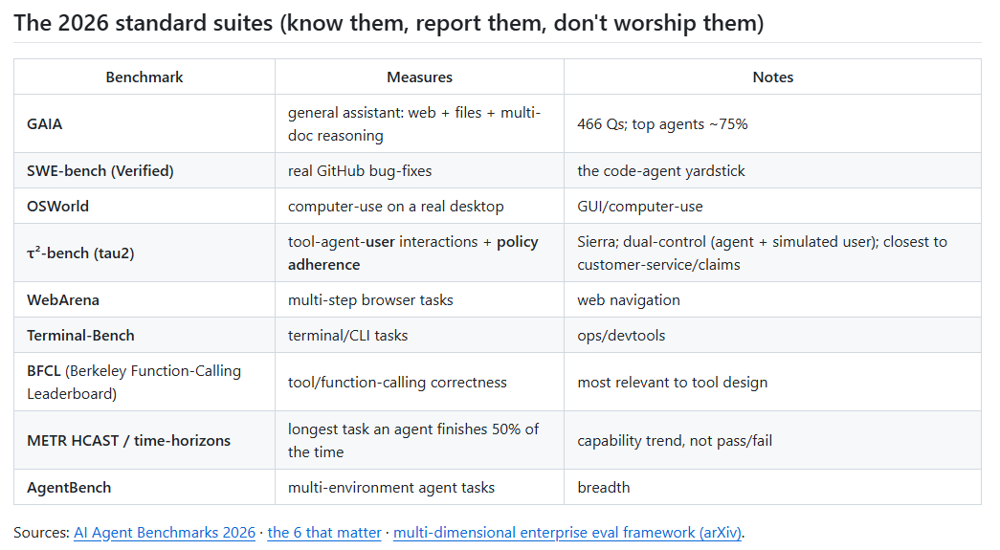

# agent-trials-method

AI Agent 评测数据集（基准测试）的介绍与使用指南。

> 说明：以下条目业界常统称「数据集」，严格说它们是「任务集 + 评测环境 + 打分规则」的组合，用于评测大模型（更准确地说是「AI Agent」）的能力。

## 数据集列表

| 编号 | 数据集 | 一句话简介 | 文档 |
|------|--------|-----------|------|
| 1 | Terminal-Bench | 终端智能体基准：在真实终端沙箱中从头到尾完成复杂工程任务 | [datasets/01-terminal-bench.md](datasets/01-Terminal-Bench.md) |
| 2 | DeepSWE | 编码智能体基准：113 个原创长周期任务，通过行为验证评估真实仓库修改 | [datasets/02-DeepSWE.md](datasets/02-DeepSWE.md) |
| 3 | Agents' Last Exam | 通用计算机使用智能体基准：在真实职业软件环境中完成 GUI 与 CLI 交织的长周期任务 | [datasets/03-Agents-Last-Exam.md](datasets/03-Agents-Last-Exam.md) |
| 4 | AutomationBench | 业务流自动化基准：在 47 个模拟 SaaS 应用中完成跨系统工作流并按终态断言评分 | [datasets/04-AutomationBench.md](datasets/04-AutomationBench.md) |
| 5 | HLE w/Tools | 学术天花板基准的开卷配置：共用 HLE 题库，允许联网搜索与代码执行 | [datasets/05-HLE-w-Tools.md](datasets/05-HLE-w-Tools.md) |
| 6 | GDPVal-AA v2 | 知识工作交付基准：通过多模型盲评与 Elo 评估真实职业交付物的相对质量 | [datasets/06-GDPVal-AA-v2.md](datasets/06-GDPVal-AA-v2.md) |

## 数据集对比

| 基准 | 内部数据 | 测试能力 | 数据样式 | 本地测试（实测状态） |
|------|----------|----------|----------|----------------------|
| Terminal-Bench 3.0 | 66 任务，7 领域 31 子领域，全容器化 | 编程 / SWE 向 | Harbor 格式 | 已跑通 |
| DeepSWE | 113 原创长周期任务，91 真实仓库、5 语言 | 编程 / SWE 向 | Harbor 格式 | 已跑通 |
| Agents' Last Exam | ~1500 任务实例，13 行业簇 55 职业，公开 122 个 | 计算机使用向，GUI + CLI 交织的完整职业工作流交付 | 自研 cua_bench 框架，任务 = 可执行 main.py | 未尝试 |
| AutomationBench | 600 公开任务（6 域 ×100）+ 私有留出集，47 个模拟 SaaS | 工具调用向 | 代码即数据，tasks.py + 断言库，跑在 verifiers 框架上 | 已跑通 |
| HLE w/Tools | HLE 题库 2500 题（纯文本 2158），100+ 学科，按“六模型全错”选题 | 检索 / 研究向 | HuggingFace 问答对 | 未尝试，只梳理了 |
| GDPVal-AA v2 | OpenAI GDPval gold 子集 220 题（44 职业 ×5），真实职业委托 | 知识工作向 | 也托管在 HuggingFace 上，静态文件包 | 未尝试，只梳理了 |

## 其他数据集

