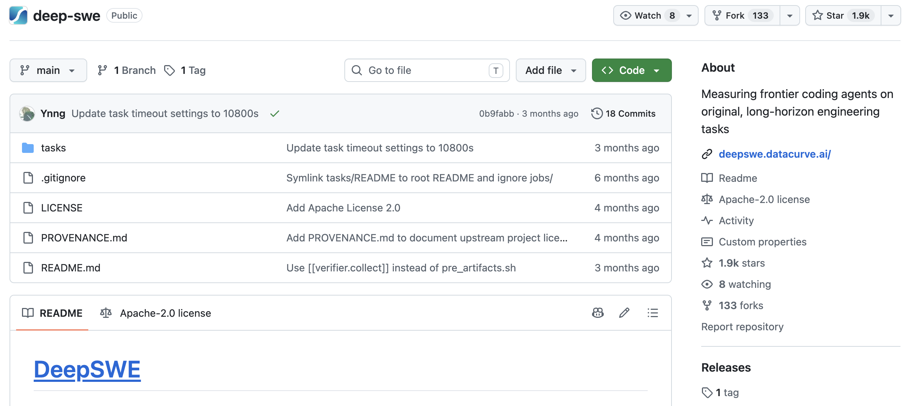
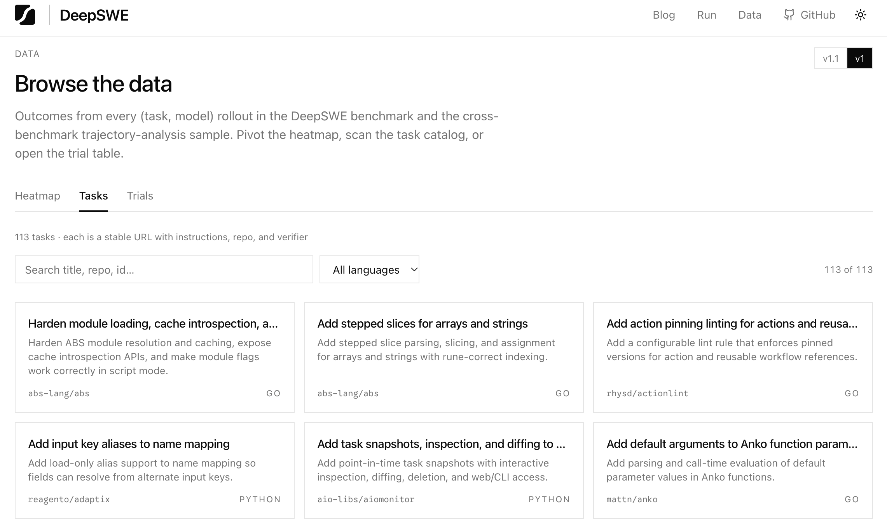
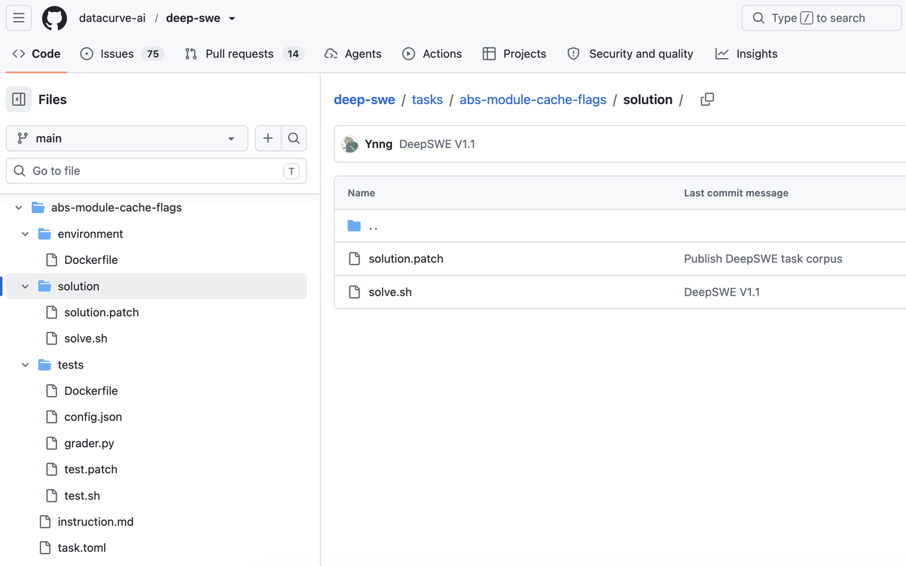
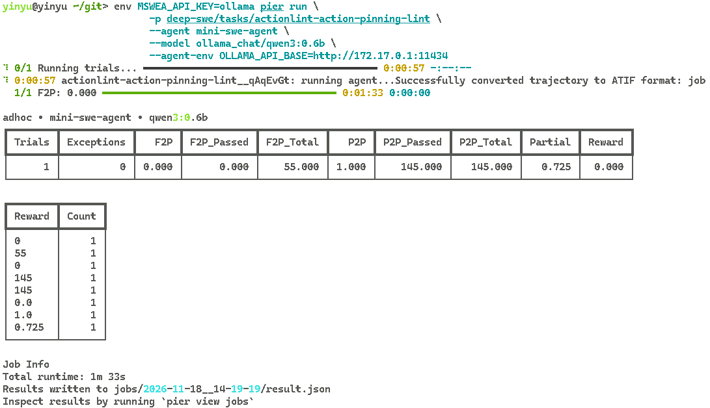

# 2. DeepSWE

由 AI 数据基础设施公司 Datacurve 开发和运营的编码智能体基准，2026 年 5 月作为其首个公开产品发布，当前最新版本为 **v1.1**。

- 官网和排行榜：https://deepswe.datacurve.ai
- 论文：https://arxiv.org/abs/2607.07946
- 代码与任务仓库：https://github.com/datacurve-ai/deep-swe



## 2.1 内部数据

**113 个从零原创的长周期软件工程任务**，覆盖 **91 个活跃开源仓库**、**5 种语言**（TypeScript、Go、Python、JavaScript、Rust），针对编程。规模设计上有意分散：贡献任务数的仓库中位数是 1 个，没有任何单一仓库能主导榜单。

它针对的是 SWE-bench 系的两大原罪：

- **防数据污染**：任务全部新写、从不回馈上游仓库，参考解不会进入模型预训练能爬到的公开记录；且浅克隆仓库防止模型从 git log 里翻答案（审计发现 Claude Opus 在 SWE-bench Pro 上超 12% 的 trial 这么干过）。
- **任务真实重量**：prompt 长度只有 SWE-bench Pro 的一半，但参考解平均改动 **668 行代码、横跨 7 个文件**（SWE-bench Pro 是 120 行 / 5 文件）。



## 2.2 测试能力

DeepSWE 测的是**智能体式编码（agentic coding）而非代码生成**：读陌生仓库、理解各部件如何协作、写出与现有系统交互的代码、跑测试、迭代修复。

评分机制的两个关键设计：

- **行为验证而非实现验证**：每个任务由手写验证器检查“可观察的软件行为”，接受任何实现——变量名不同、多改了文件都没关系，测试绿了就得分。这让它的误判率远低于 SWE-bench Pro：误杀正确解 **1.1% vs 24%**，误放错误解 **0.3% vs 8.5%**。
- **统一公平跑道**：官方榜单所有模型跑同一套 mini-swe-agent harness、同一 prompt、无网络隔离容器，Pass@1 计分；v1.1 进一步把提交的补丁放到干净容器里评分，并修剪 git 引用防作弊。

区分度上它比同期榜单更“拉得开”：v1.1 榜首约 **74%**，榜尾 **12%**，横跨近 60 个百分点。

## 2.3 数据样式

采用与 Terminal-Bench 相同的 Harbor 任务格式，仓库里即可看到每个任务目录：



具体参考 [01-terminal-bench.md](./01-Terminal-Bench.md)

## 2.4 评测流程

1. **环境启动**：按任务 Dockerfile 构建无网络隔离容器，浅克隆目标开源仓库（无 git 历史、修剪引用，防翻答案），agent 拿到一段简短的自然语言任务描述。
2. **Agent 执行**：统一用 mini-swe-agent harness，模型在容器里自由探索代码、编辑文件、跑测试、迭代修复，最终以 git diff 补丁形式产出改动（Pass@1，一次机会）。
3. **干净容器判分**：补丁送进全新干净容器重放，任务作者手写的行为验证器跑测试——不看实现方式，测试全绿得 1 分，否则 0 分；113 题平均即最终成绩。

## 2.5 本地测试

测试本地模型比较麻烦，需要先把任务 `task.toml` 里的两处 `network_mode = "no-network"` 改成 `public`。pier 用 docker-compose 会自建一个项目网络，因此要通过 WSL 自己的 `eth0` IP 访问本机 Ollama。

以下命令在任务仓库的父目录执行：

```bash
# 确认 Ollama 服务和模型都在（同上）
ollama list                        # qwen3:0.6b
curl http://localhost:11434

# 查 WSL 的 eth0 IP（取第一个）
hostname -I

# 先用容器验证这个 IP 通不通（把 <IP> 换成上面查到的）
docker run --rm curlimages/curl http://<IP>:11434

# 拉取任务仓库（113 个任务，Harbor 格式）
git clone https://github.com/datacurve-ai/deep-swe

# 本地复现不需要防作弊隔离，模型就在本机
sed -i 's/network_mode = "no-network"/network_mode = "public"/g' deep-swe/tasks/actionlint-action-pinning-lint/task.toml
grep network_mode deep-swe/tasks/actionlint-action-pinning-lint/task.toml

# 装 pier（官方 runner，自带 mini-swe-agent 驱动）
uv tool install datacurve-pier

# 单任务试水：先 ls 挑一个任务 id
ls deep-swe/tasks
env MSWEA_API_KEY=ollama pier run \
  -p deep-swe/tasks/actionlint-action-pinning-lint \
  --agent mini-swe-agent \
  --model ollama_chat/qwen3:0.6b \
  --agent-env OLLAMA_API_BASE=http://<IP>:11434
```



交互式查看结果（要安装好 pier 的前端模块）：

```bash
pier view ~/git/jobs
```
