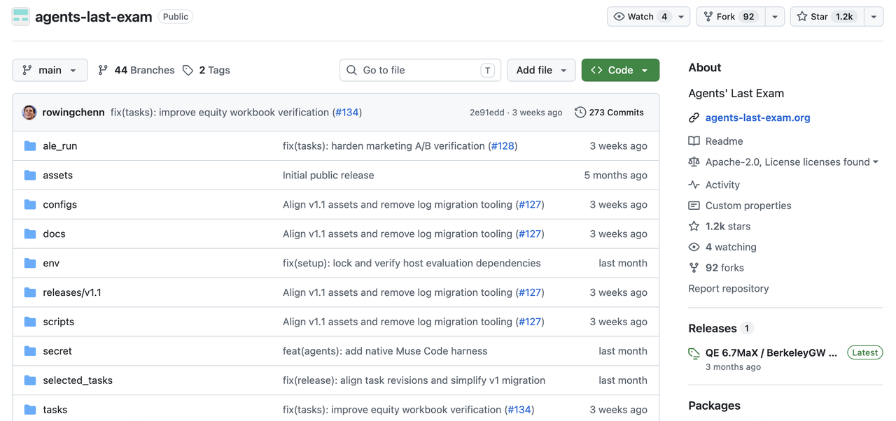
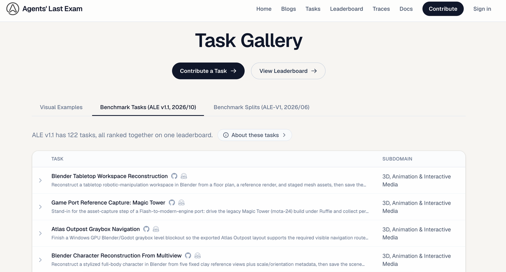

# 3. Agents' Last Exam

由 UC Berkeley RDI（Dawn Song 团队）牵头、Snorkel AI 开放基准计划参与共建的通用计算机使用智能体基准，250+ 行业专家参与出题，2026 年 6 月发布，当前最新为 **v1.1**。

- 官网和排行榜：https://agents-last-exam.org （`/leaderboard`；`/demo` 可浏览公开任务）
- 论文：https://arxiv.org/abs/2606.05405
- 评测框架：https://github.com/rdi-berkeley/agents-last-exam



## 3.1 内部数据

总规模约 **1,500 个任务实例**，横跨 **13 个行业簇、55 个非体力职业子领域**，按 O*NET/SOC 2018 联邦职业分类法锚定。为防止污染只公开约 10%（v1.1 淘汰 30 题后剩 **122 个公开活跃任务**）。

三个区别于合成基准的设计：

- **任务来自真实交付**：专家贡献的是自己工作中已完成的项目（而非编造的玩具场景），经“专家出题 → 提交 → 同行评审 → 工程实现 → QC”五关才入库。
- **真实生产软件环境**：完整 GUI + CLI 的计算机使用环境——Moldex3D 注塑仿真、Dorico 打谱、Blender 动画、PowerMill CAM、LibreOffice 财务模型，而不是简化沙箱。
- **三档难度分层**：Near-Term（现有 agent 已能部分完成）、Full-Spectrum（广覆盖）、Last-Exam（最难工作流），发布时最强配置在最难档平均通过率仅 **2.6%**。



## 3.2 测试能力

ALE 测的是**通用计算机使用智能体（GCUA）能否交付真实职业工作**：GUI 操作（桌面软件、浏览器）与 CLI 操作（脚本、代码、文件）交织的长周期任务，考察的是现有基准各自孤立测试的能力的并集。

评分机制是它最精巧的部分，沿两个正交维度组合：

- **比对形式（按产物类型选）**：精确 / 哈希值比对、带容差的结构化数值（财务、临床数据主流）、几何面距离（3D 网格对参考 STL）、视觉外观（视觉 LLM 裁判）、行为 / 世界状态回放（游戏存档、仿真日志）、自由文本 rubric。
- **组合方式**：最常用 gate-and-score——硬性闸门不过直接 0 分（如“刀路无碰撞”“文件可解析”），过了才评连续质量分，防止“形似神不似”的产物骗分。
- **LLM 裁判只做窄口径 yes/no 探针**（“提交的预览视频与参考动作一致到能过吗”），加权、闸门、聚合全在代码里完成，LLM 不当自由裁量的法官。

结果以**满分通过率 + 部分分（[0, 1] 连续分）**双指标报告，两者不可合并。

## 3.3 数据样式

仓库结构如下：

```text
agents-last-exam/
├── ale_run/            # 评测工具包（核心：provisioning / 运行 / 评分编排）
├── tasks/              # 全部任务，按行业簇分目录
│   ├── business_finance/
│   ├── engineering/
│   ├── health_medicine/
│   ├── legal/ ...（13 个行业簇 + demo/）
│   ├── common_config.py / common_setup.py / linux_runtime.py   # 共享基类
│   └── published_tasks.json    # 公开任务清单
├── selected_tasks/     # 任务列表文件：full.txt(122) / cpu.txt(119) / gpu.txt(3)
│                       #   ale_cli.txt(86) / docker_support.txt(78)
├── configs/            # agent / 环境配置
├── env/                # 宿主机依赖安装与自检脚本
├── secret/             # API key（.env）
├── example_exp.yaml    # 实验配置样例（一个实验 = 1 agent × 1 环境 × N 任务）
└── docs/  assets/  scripts/  releases/
```

**单个任务 = 一个可执行的 main.py**。

以 `tasks/demo/hello/`（[main.py](https://github.com/rdi-berkeley/agents-last-exam/blob/main/tasks/demo/hello/main.py)）为例，`main.py` 用 `cua_bench` 框架写成，固定三段式：

- **TaskConfig**：声明路径和任务描述。hello 任务的指令大意：“用桌面 GUI（截图、点击、打字）操作一个网页订单应用，把生成的确认码写到 `output/result.txt`”——并明确提示答案从文件里拿不到，必须用 GUI。
- **setup_task()**：环境准备钩子——清空输出目录、校验框架预置的输入文件就位。
- **evaluate(task_cfg, session) -> list[float]**：评分函数——读 agent 写的 `result.txt` 与解密后的参考答案精确比对，对得 1.0、错得 0.0（输出读不到也是 0.0）。

## 3.4 评测流程

1. **环境启动与注入**：按实验配置（1 agent × 1 环境 × N 任务）创建沙箱（VM 或 Docker），把任务物料（输入文件、预置软件）放进去，然后注入 agent——CLI harness 直接装进机器里，或外部通过 CLI + GUI 两个 MCP 桥远程驱动。agent 只拿到任务描述。
2. **Agent 执行到结束**：agent 在真实操作系统上自由工作——终端命令、代码、GUI 截图点击混用，直到自行宣布完成或超时，框架全程记录统一格式的轨迹（每步、工具调用、观察）。
3. **后置参考答案判分**：agent 结束后才把加密的参考答案解密注入环境，任务自带的 `evaluate()` 函数运行（精确匹配、数值容差、几何比对或 LLM 探针），产出 [0, 1] 分数；连同原始日志和产物文件一起归档，全程可重放审计。

## 3.5 本地测试

要拉数 GB 的 VM 镜像、配 QEMU，多数评分需要云端模型 API key（评分探针本身调视觉 LLM）。用本地 Ollama `qwen3:0.6b` 没有官方支持的接法，需要自己改 agent 配置把模型端点指向本地。

跑起来比较麻烦，后续再研究。

```bash
# 克隆评测框架
git clone https://github.com/rdi-berkeley/agents-last-exam.git
cd agents-last-exam

# 装宿主机依赖 + 锁定依赖同步 + 环境自检
bash env/install_host_deps.sh
uv sync --all-packages --locked
bash env/verify_host_env.sh

# 配置密钥（模型 API key 等）和实验配置
cp -n secret/.env.example secret/.env
cp example_exp.yaml my_experiment.yaml
```
