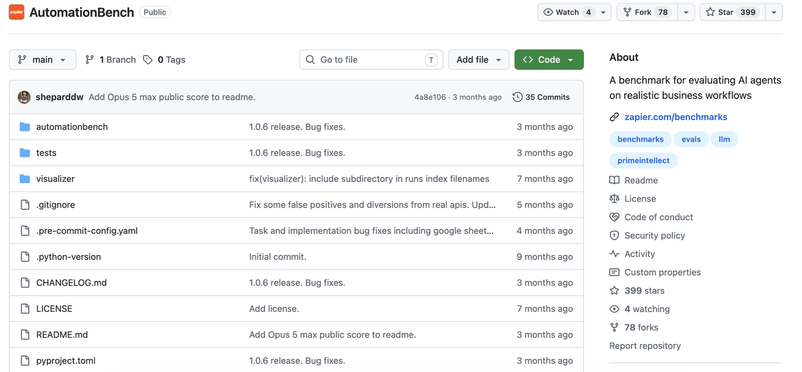
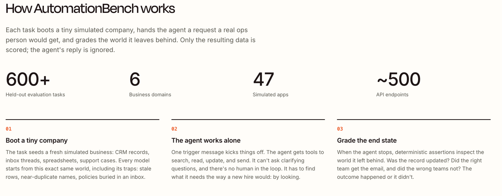
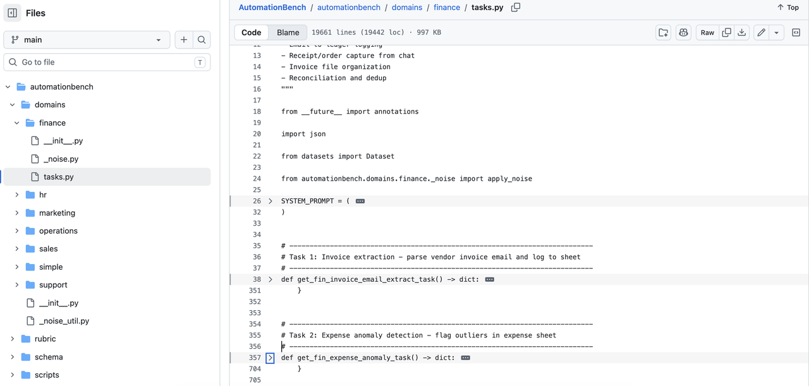
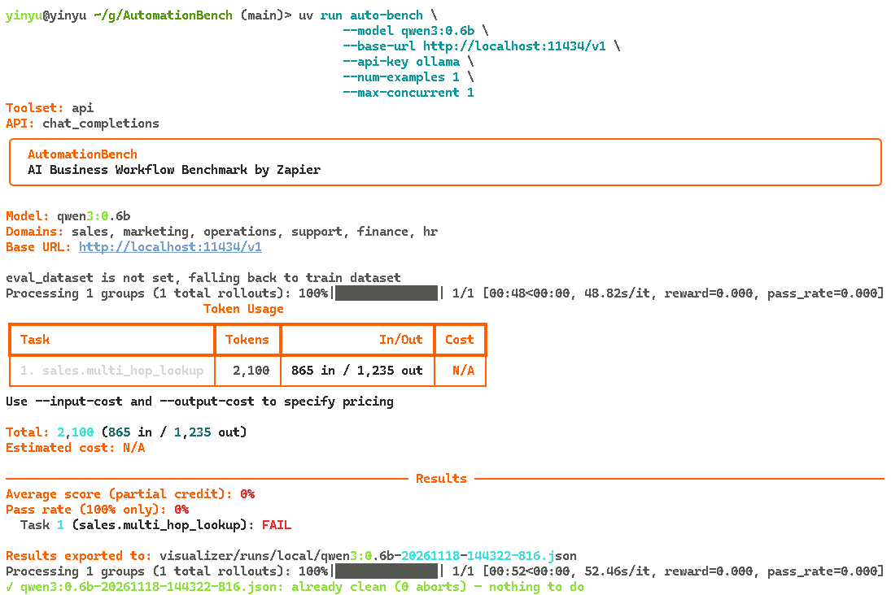
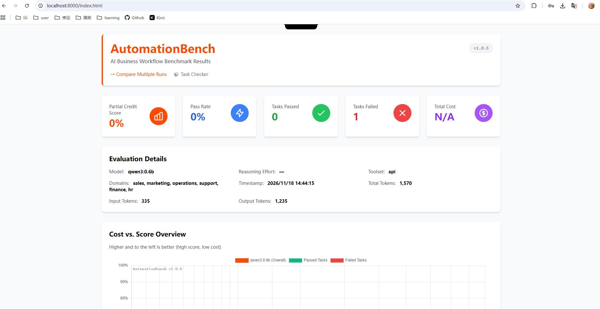

# 4. AutomationBench

由 Zapier 于 2026 年 4 月发布的业务流自动化基准，任务模式取自其平台上 370 万家公司、每月 20 亿次自动化任务的真实用法；当前版本 **v1.0.6**。

- 官网和排行榜：https://zapier.com/benchmarks
- 论文：https://arxiv.org/abs/2604.18934
- 代码与公开任务：https://github.com/zapier/AutomationBench



## 4.1 内部数据

**600 个公开计分任务**（销售、市场、运营、客服、财务、HR 各 100 题）+ **200 个不计分的 simple 热身题**；官方榜单用的是另一套**私有留出集（657 题）**，分布相似但刻意更难、不公开，所以本地跑的分和官方榜不会 1:1 一致，只有方向性参考意义。

环境是它的核心资产：**47 个模拟 SaaS 应用**（CRM、邮箱、日历、表格、IM 等）、**约 500 个 REST 端点**，模拟器本体约 **8.5 万行 Python**。任务刻意埋了真实工作的“脏”：同名联系人、不一致的格式、误导性记录、藏在数据里的分层政策文。



## 4.2 测试能力

测的是**跨应用工作流编排**：一个任务横跨 CRM + 邮箱 + 日历 + 消息平台，agent 必须自己完成三件事——自主发现端点（没有现成工具列表，要用 `api_search` 找）、遵守政策文档（比如“成交通知该发哪个组、主题行怎么写”写在环境数据里）、把正确数据写进正确的系统。

评分设计：

- **只验最终状态，完全不看过程**：正确的记录更新了、正确的邮件发出了就得分；调用顺序、效率无关（多调几次只影响成本统计）。
- **确定性断言，无 LLM 评委**：每题一组 assertion（约 350 种断言类型）对照各应用最终状态逐条检查。
- **双指标**：`task_completed_correctly`（全部断言通过才记 1，官方榜单指标，跑间方差 <1%）；`partial_credit`（通过断言的比例，仅作诊断和 RL 训练的稠密奖励）。
- **guardrail 断言**：运行前为假、运行后必须仍为假的红线（比如“不许给 vp-sales 发这封邮件”），违反即记 0。

发布时最好的前沿模型得分不到 **10%**，目前榜首在 **50%** 上下——区分度保持得很好。

## 4.3 数据样式

按业务域分目录，每个域一个巨大的 `tasks.py`：

```text
automationbench/domains/
├── sales/        tasks.py   # 1.5 MB / 3.2 万行 = 销售 100 题
│                 _noise.py  # 126 KB：干扰数据（同名联系人、误导性记录）
├── marketing/    tasks.py   # 市场 100 题
├── operations/   tasks.py   # 运营 100 题
├── support/      tasks.py   # 客服 100 题
├── finance/      tasks.py   # 财务 100 题
├── hr/           tasks.py   # HR 100 题
└── simple/       tasks.py   # 408 KB：200 道不计分的热身题
```

每道题就是文件里的一个 Python 数据结构：`prompt`（触发消息）、初始状态播种、可用工具范围、`assertions` 列表。`_noise.py` 就是之前说的“埋脏数据”那部分——让环境里存在相似名字、格式不一的干扰项。



## 4.4 评测流程

1. **播种环境**：初始化模拟公司（47 个应用的初始数据 + 触发消息），agent 只拿到一段自然语言请求（如“这单成了，按我们的路由政策通知相关团队”）。
2. **Agent 执行**：在 50 轮上限内自主用 `api_search` 发现端点、读政策文档、调 REST API 完成多步链路，全程无用户交互。
3. **终态断言判分**：评分器直接读各应用的最终状态，逐条对照断言——全过记 1 否则记 0，同时输出 `partial_credit`；600 题平均即总分。

## 4.5 本地测试

```bash
git clone https://github.com/zapier/AutomationBench.git
cd AutomationBench
uv sync

# 官方快速上手（默认走云端 API 模型）
uv run auto-bench --model gpt-5-mini

# 测试本地模型
uv run auto-bench \
  --model qwen3:0.6b \
  --base-url http://localhost:11434/v1 \
  --api-key ollama \
  --num-examples 1 \
  --max-concurrent 1
```



交互界面：

```bash
python3 visualizer/serve.py
```


