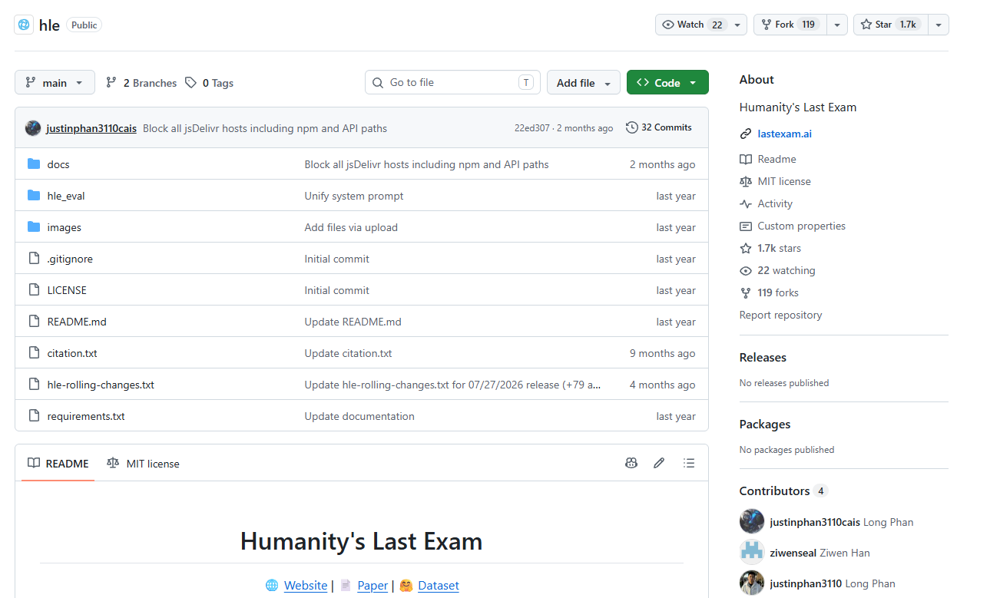
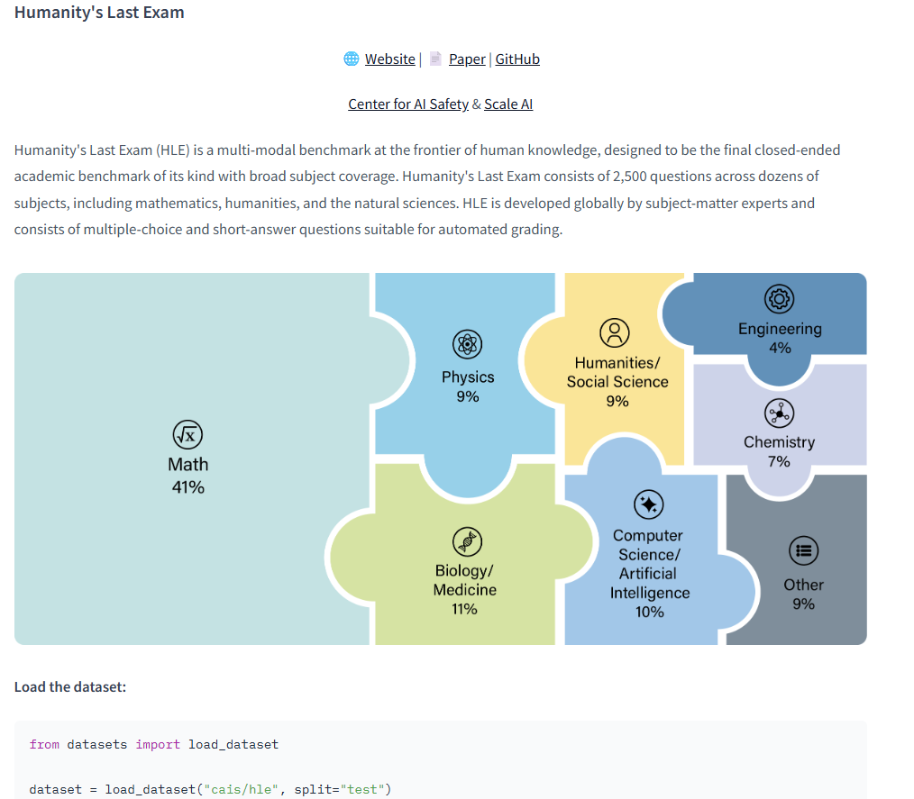

# 5. HLE w/Tools

由 Center for AI Safety（CAIS）与 Scale AI 联合发布的学术天花板基准，2025 年 1 月面世，全球 1000 多名学科专家参与出题。**“w/Tools”不是独立数据集，而是同一份 HLE 题库的开卷评测配置**——允许模型调联网搜索、代码执行等工具，与闭卷的 HLE 本体共用数据和判分，只是考试规则不同。

- 官网：https://lastexam.ai
- 论文：https://arxiv.org/abs/2501.14249
- 数据集：https://huggingface.co/datasets/cais/hle （需登录同意条款才能下载）
- 评测代码：https://github.com/centerforaisafety/hle

## 5.1 内部数据

最终定稿 **2500 题**（从 2025 年 1 月公布的 3000 题、论文版 2700 题修订而来），覆盖 **100 多个学科**，约 **14%** 带图（多模态），多数排行榜实际跑的是 **2158 题的纯文本子集**。

三个值得知道的设计与沿革：

- **按“模型盲区”选题**：题目入库的前提是当时六个前沿模型全部答错，天然锚定能力天花板。
- **防污染三件套**：数据集内嵌 canary 字符串供训练方过滤、CAIS 持有私有留出集检测过拟合、定稿时系统性剔除“开搜索就能答对”的可搜索题。
- **质量争议与衍生版本**：2025 年 7 月 FutureHouse 审计称化学 / 生物类约 30% 答案与文献冲突；官方随后推出持续更新的 HLE-Rolling（2025 年 10 月），2026 年 9 月发布精修子集 HLE-Diamond（1000 题：500 推理 + 500 知识）。

## 5.2 测试能力

HLE 本体测的是**闭卷的专家级知识与多步推理**——PhD 级封闭问题，故意设计成搜索引擎直接搜不到答案。

w/Tools 配置把考察目标换成 **agent 的检索与工具编排能力**：同一模型给上联网搜索和代码执行，测的就是深度检索、多步验证、工具组合——方向上和 Terminal-Bench / DeepSWE 一致，只是载体是学术题而非工程任务。

工具带来的分差极大，这是它单列的原因：HLE-Diamond 上 GPT-6 Astra 闭卷 **59.9%**、开搜索 + 代码 **82.9%**。看到任何 HLE 分数先问两句：**带没带工具？跑的哪个版本（原始 2500 / 纯文本 2158 / Diamond 1000）？**两个口径的分不可比。

## 5.3 数据样式

数据形式最轻量——没有仓库、没有容器、没有测试脚本，就是 Hugging Face 上一份“题目 + 标准答案”的问答对数据集。每条记录一行：

- **`id`**：题目 ID。
- **`question`**：题面文本（多模态题另有 `image` 字段）。
- **`answer`**：封闭形式标准答案（选项字母或精确匹配短答案）。
- **`answer_type`**：`multipleChoice` 或 `exactMatch`，决定判分方式。
- **`subject` / `category`**：学科分类。
- **`canary`**：防污染标记串。

工具栈、harness、判分器全不随数据发布——w/Tools 的工具环境由各评测方自己搭。

## 5.4 评测流程

1. **答题**：闭卷版直接发题；w/Tools 版把题放进 agent 循环，模型自主调搜索 / 代码工具，最终输出答案 + 0～100% 置信度（置信度用于算校准误差，HLE 特有指标）。
2. **判分**：答案封闭但表述有自由度，用 judge 模型（官方为 `o3-mini-2025-01-31`）将模型回答与标准答案比对，输出对 / 错；选择题等价于精确匹配。
3. **汇总**：主指标 pass@1 准确率，辅以校准误差（RMSCE）；榜单按“是否带工具 × 哪个子集”分列。

## 5.5 本地测试

需要登录 Hugging Face 才能拿到数据集。可以抽样 20 道选择题，写脚本发到本地 `http://localhost:11434/v1`，选择题用本地精确匹配判分，后面有需要再研究。
