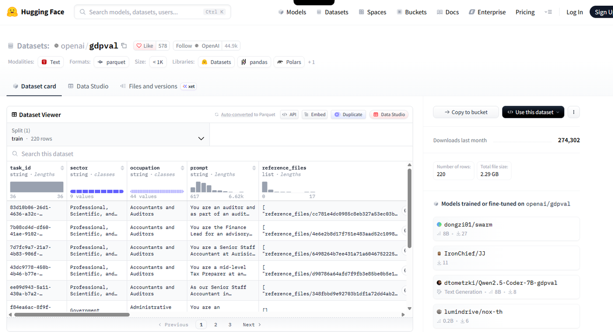

# 6. GDPVal-AA v2

**GDPVal-AA 不是独立数据集，而是 Artificial Analysis 对 OpenAI GDPval 数据集的独立复测框架**——“AA”就是 Artificial Analysis，“v2”是它 2026 年 6 月 15 日随 Intelligence Index v4.1 发布的方法论版本。数据是 OpenAI 的，agent 执行环境和判分体系是 AA 自己的。

- GDPval 论文：https://arxiv.org/abs/2510.04374
- 数据集：https://huggingface.co/datasets/openai/gdpval （gold 子集公开）
- AA 榜单页：https://artificialanalysis.ai/evaluations

## 6.1 内部数据

数据本体是 OpenAI 的 GDPval：完整集 **1320 个任务**（44 种职业 × 各 30 题），选自对美国 GDP 贡献超 5% 的 **9 大行业**（金融、医疗、法律、制造、政府等），任务来自真实职业工作，专家中位耗时 **4 小时 / 题**。公开的只有 gold 子集 **220 题**（每职业 5 题）——GDPVal-AA 跑的就是这 220 题。

v2 相比 v1 的方法论改动（2026 年 6 月）有四条：

- **Elo 重新锚定**：人类专家交付物定为约 1000 分——高于 1000 意味着模型交付物被判定优于职业人类，这是 v2 最重要的变化，分数从此有了“是否超人”的直观解释。
- **单一裁判 → 三人裁判团**：v1 只有一个 LLM judge，v2 换成三个前沿模型轮流评审，降低单个裁判的风格偏好。
- **步数上限 100 → 250 轮**：允许更长周期的 agent 任务。
- **沙箱升级**：扩充软件依赖，支持更多文件类型。

在 AA 的综合 Intelligence Index 里，GDPVal-AA 权重 **20%**，是所有单项评测里最高的。

## 6.2 测试能力

测的是**知识工作的交付能力**——不是答题，是“交活”：写法律备忘录、做投行财务模型的电子表格、做幻灯片、画工程图，产出真实工作产品（文档、表格、幻灯片、示意图）。

执行方式是 agentic 的：模型在 AA 的 Stirrup harness 里拿 shell 访问、代码执行沙箱、联网搜索和网页抓取，循环工作直到交付。所以它和你前面几个基准的区别在于：Terminal-Bench / DeepSWE 测“把工程做对”（有客观测试判对错），GDPVal-AA 测“把活干漂亮”（靠同行盲评比优劣）——评的是开放式交付物的相对质量，没有标准答案。

当前榜首量级参考：Claude Opus 5 在 v2 口径下 Elo **1861**（max effort）——远高于 1000 的人类基线，即前沿模型在这批任务上已被判定整体优于职业人类。

## 6.3 数据样式

HF 上的 `openai/gdpval` 数据集，每条任务记录包含：

- **任务请求（prompt）**：一段工作委托描述，比如“为这起并购案建一个三表联动的估值模型”。
- **参考文件**：完成任务所需的输入材料（原始数据、背景文档等）。
- **人类专家交付物**：职业人士实际做出的成品文件（xlsx / pptx / docx 等），作为盲评对照。
- **评分 rubric**：全库共 **10453 条**人工撰写的评分标准，中位数每题 **47 条**。

和 ALE 的“可执行 `main.py`”完全不同：任务是静态文件包，没有代码、没有容器、没有自动判分脚本——判分逻辑（盲评配对、Elo 聚合）全在 AA 侧的 harness 里。

## 6.4 评测流程

1. **Agent 执行**：模型进 Stirrup harness，拿任务请求和参考文件，用 shell + 代码执行 + 联网能力循环工作（v2 上限 250 轮），产出交付文件。
2. **盲评配对**：同一任务上，两个模型（或模型 vs 人类专家）的交付物匿名配对，三人 LLM 裁判团对照 rubric 选出更优者。
3. **Elo 聚合**：所有 pairwise 胜负拟合成 Elo 分——v2 锚定人类专家 ≈1000；v2.1 改锚 DeepSeek V4.1 Flash (max)=1600 并用 Crowd-BT 模型拟合，排名基本保持但数值不可跨版本比较。

## 6.5 本地测试

数据公开、判分封闭，是六个基准里“能看不能跑”的典型：

- **能做的**：从 HF 下载 220 题，读任务请求和参考文件，把 prompt 发给本地 Ollama，让它产出交付文件——数据和输入完全可得。
- **做不到的**：复现分数。Elo 需要多模型 pairwise 盲评 + 前沿模型裁判团，本地没有可比的对手池和裁判，单个模型跑不出 Elo；即便自评，0.6B 模型产出的“投行估值模型 xlsx”离可用交付物差得太远。
